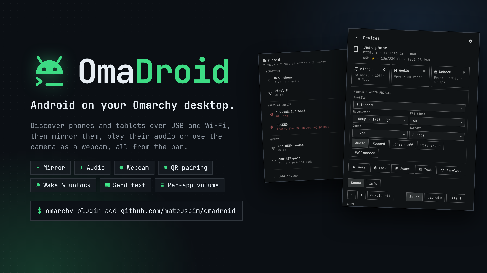

#  OmaDroid



**Android on your Omarchy desktop.** OmaDroid is a bar widget that finds your
phones and tablets over USB and Wi-Fi (ADB and mDNS), then mirrors them, plays
their audio or uses their camera as a webcam with
[scrcpy](https://github.com/Genymobile/scrcpy), all from one popup that follows
your Omarchy theme.

[Install](#install) · [Remove](#remove) · [Requirements](#requirements-and-enabling) ·
[Features](#features) · [Architecture](docs/architecture.md) ·
[Changelog](CHANGELOG.md)

- **One click per session:** Mirror, Audio or Webcam. Starting another session
  switches to it.
- **Wireless without a cable:** pair with a QR code, a pairing code or an
  address. A USB device moves to Wi-Fi with one button, and auto-connect
  reconnects trusted devices.
- **Device controls:** wake, unlock with a PIN kept in your keyring, lock,
  keep awake and rotation.
- **Sound:** volume keys, mute all, ringer mode and per-app volume for apps
  playing sound.
- **Send text:** a hotkey opens a prompt, and what you type there is typed on
  the device.

## Quick start

1. Install the tools and the plugin (see [Install](#install)):
   `omarchy pkg add android-tools scrcpy qrencode`, then
   `omarchy plugin add https://github.com/mateuspim/omadroid --enable`.
2. On Android, enable Developer options › USB debugging (or Wireless
   debugging), then plug in the cable and accept the prompt, or pair from
   **+ Add device** › **QR code**.
3. Click the OmaDroid icon in the bar and choose the device under
   **CONNECTED**.
4. Click **Mirror**, **Audio** or **Webcam** on its page. ⚙ on a card changes
   its options; ■ on the session banner stops the session.

## Features

The popup opens on a device list grouped into **CONNECTED**, **NEEDS
ATTENTION** and **NEARBY**. Click a ready device to open its page:

1. a hero with its name, model, Android version, connection, battery, storage
   and memory;
2. three **session cards**, **Mirror**, **Audio** and **Webcam**, each with a
   live summary of what a click starts (for example "Balanced · 1080p · 8
   Mbps", "Opus · no video", "Front · 1080p · 30 fps");
3. one compact row of device controls: **Wake** (**Unlock** once a PIN is
   saved), **Lock**, **Awake**, **Text**, and **Wireless** for a USB device or
   **Disconnect** for a Wi-Fi one;
4. the **Sound** and **Info** tabs.

**+ Add device** at the bottom of the list pairs or connects a wireless
device, and ⚙ in the header opens **Settings**. A running mirror, audio or
webcam session shows as a banner on every view; click it to open that
device's page, or ■ to stop it.

- **Devices:** one process-wide discovery service follows `adb track-devices -l`
  for every monitor, so plugging in, authorizing or losing a device shows at
  once without polling, plus Avahi-based mDNS discovery that follows the network
  while the popup is open. Each row shows the device name with its model and
  battery, or what it needs (accept the USB debugging prompt, offline, …); the
  serial or service identity and address are in its tooltip. A row that needs
  you has one inline action: **Reconnect** for a wireless device that went
  offline, **Connect** for a discovered one, **Pair** for an advertised pairing
  service. The name is the one set on Android (Settings › About › Device name),
  read once per connection; devices without one show their model. The **Info**
  tab adds temperature, SD card or USB drive storage, and screen size with its
  aspect ratio, plus the serial and address with copy buttons. Sizes use
  1000-based units (GB, TB), as Android's Settings does. Details are read with
  one `adb shell` per device while the popup is open and refreshed once they
  are a minute old; nothing is read while it is closed. The bar badge counts
  authorized, ready transports. ↻ in the header (or F5) re-reads ADB and
  restarts the Avahi browsers; its tooltip says how fresh the list is. If the
  ADB tracker stops (adb missing, its server restarting), OmaDroid polls
  `adb devices -l` every 15 seconds by default (**Scan interval** in Settings
  accepts 5–3600 seconds) and retries the tracker with a growing delay of up
  to a minute.
- **Wireless:** **Add device** pairs by scanning a QR code with Android
  (**QR code**), by six-digit code (**Pairing code**, prefilled from
  discovered services) or connects to a paired device by manual `IP:port` /
  `hostname:port` / `[IPv6]:port` entry (**Address**). A USB device's
  **Wireless** control moves it to Wi-Fi so the cable can be unplugged, and a
  wireless device's **Disconnect** drops the connection. See
  [Pair with a QR code](#pair-with-a-qr-code) and [Go wireless](#go-wireless).
- **Session cards:** a click starts that session with the options shown in its
  summary. ⚙ on a card opens its options under the cards, one panel at a
  time: **Mirror** and **Audio** share the **Mirror & Audio profile**
  (resolution, FPS, H.264/H.265/AV1 codec, video bitrate, and the **Audio**,
  **Record**, **Screen off**, **Stay awake** and **Fullscreen** options);
  **Webcam** has its camera settings. **Audio** plays the device's sound
  without a scrcpy window (`--no-video --no-window`); its optional recordings
  are saved as `.mka`. While a session runs on the device, its controls
  (Preview, Log, Stop, battery, recording, phone screen and rotation) show
  under the cards. See [Mirroring and profiles](#mirroring-and-profiles) and
  [Android webcam setup](#android-webcam-setup).
- **One-click switching:** only one session runs at a time. Starting any
  session while another runs, of another kind or on another phone, stops it
  and starts the new one: the cards read "Switch · stops …" and the banner
  "Switching to …" until it starts, and ■ cancels the switch. A mirror that
  records asks first ("Stop recording & switch?"): click again within about 4
  seconds to finalize the recording and switch. A session that is still
  starting can't be switched; the other cards wait until it runs. The running
  session's card reads "● Running", and clicking it stops the session.
- **Rotation:** the four orientation buttons during a video session lock the
  device to portrait, landscape, or either inverted orientation. **Auto
  rotate / reset** restores Android's sensor rotation. A lock set from
  OmaDroid is released when the session ends; a lock set on the phone is kept.
- **Keep awake, wake, unlock and lock:** **Awake**, **Wake** (**Unlock** once
  a PIN is saved) and **Lock** in the control row; the PIN is saved under
  **Unlock PIN** in the **Info** tab. See [Keep awake and unlock](#keep-awake-and-unlock).
- **Sound:** the **Sound** tab has the device's volume keys, mute all, ringer
  mode, per-app volume and mute for the apps playing sound, and the system
  sound streams. See [Sound](#sound).
- **Send text:** a hotkey, or the **Text** control, opens a centered prompt;
  what you type there is typed on the device. See [Send text](#send-text).

The popup follows the active Omarchy theme and uses its native buttons, inputs,
dropdowns, typography, and keyboard focus styles. Tab moves between controls;
Enter/Space activates buttons and opens a focused device row; F5 refreshes;
Escape closes an open dropdown, then goes back to the device list, then
dismisses the popup. Every view scrolls when it doesn't fit.

## Install

```bash
omarchy plugin add https://github.com/mateuspim/omadroid --enable
```

`omarchy plugin update pym.omadroid` pulls new versions later.

## Remove

If you installed the Send text hotkey, remove it first: **Remove** in the
**Send text hotkey** row of Settings (⚙), or
`~/.config/omarchy/plugins/pym.omadroid/scripts/hotkey.sh remove`. This deletes only
OmaDroid's marked block in `~/.config/hypr/bindings.lua`. Then remove the
plugin:

```bash
omarchy plugin remove pym.omadroid
```

Removing the plugin leaves your settings and saved data on disk. To delete
them too:

```bash
rm -f ~/.config/omarchy/omadroid.ini     # settings and profiles
rm -rf ~/.local/state/omadroid           # per-device unlock state
rm -rf ~/.cache/omadroid                 # per-firmware audio codes
secret-tool clear app omadroid           # saved unlock PINs (keyring)
```

The webcam setup also installed a system driver. If no other app uses it, undo
it with:

```bash
sudo rm -f /etc/modules-load.d/v4l2loopback.conf /etc/modprobe.d/v4l2loopback.conf
omarchy pkg drop v4l2loopback-dkms
```

Recordings stay in the folder you chose, and the packages from
[Requirements](#requirements-and-enabling) stay installed.

## Security and privileges

OmaDroid runs as your user. Loading the plugin installs nothing, writes no
config outside its own settings, and never calls `sudo`.

- **Root only when you ask:** **Set up webcam** opens a visible terminal that
  installs `v4l2loopback-dkms` and loads it with `sudo`; the commands are
  fixed.
- **Your config:** only the Send text hotkey's **Install** writes outside the
  plugin, as one marked block in `~/.config/hypr/bindings.lua`.
- **Secrets:** unlock PINs stay in your keyring; PINs, pairing codes and typed
  text travel on stdin, never in process arguments, logs or settings.
- **Network:** only the devices you pair or connect; nothing is downloaded.

[SECURITY.md](SECURITY.md) lists every command OmaDroid runs and every file it
writes, and how to report a vulnerability.

## Requirements and enabling

Install the ADB tools, scrcpy, and `qrencode` for QR pairing:

```bash
omarchy pkg add android-tools scrcpy qrencode
```

Requires Omarchy's Quickshell shell, Qt 6.5+, `adb`, Bash, `awk`, GNU coreutils
(`timeout`), util-linux (`flock`, `setsid`, `setpriv`, `waitpid`), Avahi
(`avahi-browse` and a running `avahi-daemon`), foot (preferred for the hidden
session terminal) or an Omarchy default terminal, and scrcpy 4.1+ for
mirroring, audio, the webcam and idle prevention. This implementation was
checked against the installed scrcpy 4.1 command-line options. The bar and
popup warn when `adb`, `scrcpy`, or a configured default terminal is missing.

Optional, each only for the feature named:

- `qrencode`: pairing with a QR code.
- `secret-tool` (libsecret): saving an unlock PIN.
- `v4l2loopback-dkms`: the Android webcam (see below); `ffmpeg` (with
  `ffprobe`): its in-panel preview; `wl-copy` (wl-clipboard): **Copy
  commands** and the Info tab's copy buttons; `fuser` (psmisc), when present,
  lets OmaDroid refuse an output another app is holding.
- Python 3 (standard library only): per-app volume and **Mute all** in the
  Sound tab.
- `jq`: closing the finished sessions' hidden terminals before a new launch.
- Node: development tests only; there are no npm packages.

### Android webcam setup

Camera capture requires Android 12 or later, scrcpy 4.1+, and a Linux
`v4l2loopback` output. Until one is usable, the **Webcam** card reads "Needs
setup", and its options (⚙) say whether the package is missing, the kernel
module is unavailable or unloaded, or no output is visible. **Set up
webcam** or **Enable output** opens a visible terminal after you click it;
Omarchy's package helper and `sudo` ask for a password there. It loads one
output now and at every boot, by writing
`/etc/modules-load.d/v4l2loopback.conf` and `/etc/modprobe.d/v4l2loopback.conf`;
if either file already exists, your config is kept and only `modprobe` runs.
**Copy commands** puts the manual commands on the clipboard. On Omarchy, those
commands, which are also what the setup terminal runs, are:

```bash
omarchy pkg add v4l2loopback-dkms
sudo modprobe v4l2loopback devices=1 exclusive_caps=1
printf 'v4l2loopback\n' | sudo tee /etc/modules-load.d/v4l2loopback.conf
printf 'options v4l2loopback devices=1 exclusive_caps=1\n' | sudo tee /etc/modprobe.d/v4l2loopback.conf
```

The output then takes the next free `/dev/videoN` and the driver's default
label. To pick both, load it yourself instead, using an unused number:

```bash
sudo modprobe v4l2loopback devices=1 video_nr=10 card_label="OmaDroid Camera" exclusive_caps=1
```

A bare `modprobe` lasts until reboot; to choose your own options at boot, edit
the `options` line in `/etc/modprobe.d/v4l2loopback.conf`. See the
[v4l2loopback README](https://github.com/v4l2loopback/v4l2loopback/blob/main/README.md)
for other distributions and module options.

`exclusive_caps=1` makes the device appear as a capture device to applications
after scrcpy starts writing. If you already have loopback devices, use their
existing numbers and labels; OmaDroid lists detected loopback outputs so you
can choose the right one and checks write access before launch. Opening the
popup or the webcam options never installs or loads anything. Other USB cameras
are never listed as outputs.

Open a ready phone, pick the camera and V4L2 **Output** under the **Webcam**
card's ⚙ if the defaults don't suit, then click the card.

Opening the webcam options asks the phone for its cameras (`scrcpy --list-camera-sizes`)
once per device; **Refresh** asks again and also finds V4L2 outputs. Every camera is listed by its id,
so a phone with two front cameras offers both, and Resolution, Frame rate and
Zoom only offer what the chosen camera reports. Until the list arrives, Front
and Back and common sizes are offered.

- **Quality**: a preset (**Call** 1080p · 30 fps · 12 Mbps H.265, **Sharp** 4K
  · 30 fps · 24 Mbps H.265, **Saver** 720p · 24 fps · 6 Mbps H.264) picks the
  closest size and rate the camera supports. Resolution, Frame rate, Bitrate
  and Codec can also be set by hand under **Adjust**, which shows the preset as Custom. Over
  Wi-Fi, bitrate is usually what limits sharpness; H.265 looks better than
  H.264 at the same bitrate. Automatic resolution leaves the size to scrcpy,
  which may pick the full sensor size.
- **Adjust** (folded under the Quality summary): Resolution, Frame rate,
  Bitrate, Codec, Orientation (rotate or mirror), initial Zoom, Torch (on
  cameras with a light), and Smoothing, a `--v4l2-buffer` delay that hides
  Wi-Fi jitter.

Settings are saved in `omadroid.ini` and apply when the webcam starts;
Android cameras top out at the frame rates the phone lists (often 30 fps).
Exposure, focus and white balance stay automatic: scrcpy has no controls for
them. While a webcam runs, changing a setting shows **Apply · restart**, which
stops and restarts the webcam on the same phone and output with the new
settings. Apps reading the output may stay open through the short gap when
the size and orientation stay the same; if they change, close those apps
first, or scrcpy reports the output as busy. If a size fails, select Automatic or another size and use **Log**
for the phone's error. The Android webcam sends video only; it
does not forward the phone microphone. Start the webcam before opening OBS or a
video call, then select the chosen `/dev/videoN` or its card label as a **Video
Capture Device** in OBS or as the camera in the call. A consumer that stays
open across a size or orientation change can keep the old V4L2 format and show
garbled video; the preview detects that and says so. **Stop** on the session
controls, a click on the "● Running" card, or ■ on the session banner ends the
shared scrcpy session from any OmaDroid bar instance.

While the webcam runs, its preview shows the output inside the popup, read the
same way OBS or a call reads it, so a working preview means other apps receive
the camera. A webcam started from the popup opens its preview by itself once
scrcpy is streaming, if the popup is still open; **Preview** / **Hide** in the
session controls toggles it. An Omarchy loading screen covers it until frames
arrive. It follows the session's own output, and closes when the popup closes
or you leave the device's page. It
runs `ffmpeg`, which reads the output at its current size and writes a small
JPEG (480 px wide, about 12 per second) to OmaDroid's runtime folder; ffmpeg
also exits if the shell does. If apps reading the output receive a different
size than scrcpy writes (an app that opened it during an earlier session can
fix its old size), the preview says so instead of showing garbled video: close
every app using the output, then stop and start the webcam.

To work on a local checkout, link it in place of the installed copy:

```text
~/.config/omarchy/plugins/pym.omadroid → /path/to/your/omadroid checkout
```

If the widget is not already in the bar, enable it with:

```bash
omarchy plugin enable pym.omadroid --section right
```

OmaDroid does not modify packaged Omarchy files or Omarchy's configuration:
every option is in the popup's **Settings** (⚙) and saved in OmaDroid's own
`~/.config/omarchy/omadroid.ini`, under `[preferences]` and `[autoConnect]`.
Omarchy watches the user plugin directory for updates.

Before each launch, OmaDroid registers a named Hyprland window rule with
`hyprctl eval`. The rule sends its diagnostic terminal straight to the hidden
`special:omadroid` workspace without focusing it, so the scrcpy video window is
the only one you see. No Hyprland config edit is needed. Without `hyprctl` the
terminal stays visible.

## Connecting a device

For USB, enable USB debugging, connect a data cable, unlock Android, and accept
the authorization prompt. The popup shows unauthorized, offline, permission,
recovery, and other ADB states; only `device` state enables mirroring. USB is
disconnected by unplugging the cable: `adb disconnect` only disconnects network
transports.

For Android wireless debugging, keep the phone and computer on the same network:

1. Enable Developer options → Wireless debugging on Android.
2. Choose **Connect** on the discovered device under **NEARBY**. If this
   workstation is already paired, it connects immediately.
3. If the connection fails, OmaDroid opens **Add device** › **Pairing code**
   with the discovered host/IP locked in place. Open **Pair device with pairing code** on Android, then
   enter only its separate pairing port and six-digit code. If Android's
   pairing service is already advertised, its actual pairing port is filled in.
4. Select **Pair**. OmaDroid then connects to the connection port Android
   advertises for the same host. If that service isn't known yet, it waits for
   one discovery refresh before asking you to connect manually. **Pair** on
   an advertised pairing service and the fully manual **Pairing code** and
   **Address** forms remain available in **Add device**.

Pairing codes are passed on stdin, cleared after submission or dismissal, and
never saved in profiles or included in command arguments. Pairing grants ADB
trust; disconnecting does not forget that trust. Forget the host on Android to
revoke it. The plugin issues connection commands only on explicit clicks;
ADB itself may automatically connect to previously trusted mDNS services.

Discovery recognizes `_adb._tcp`, `_adb-tls-connect._tcp`, and
`_adb-tls-pairing._tcp`. Android runs one wireless ADB endpoint per host, so a
connection service on the host of a wireless device is merged into that device even
when the ports differ: a ready device keeps the port ADB is using (Avahi can briefly
hold a stale one), and an offline device takes the newly advertised port, so its
**Reconnect** button reconnects after Wireless debugging is toggled. Offline entries ADB
keeps for a host that is ready again on another port are hidden. USB and Wi-Fi
remain separate transports, and pairing ports remain distinct. mDNS does not supply a reliable hardware serial or model name,
so unconnected entries explicitly show a service identity instead.

The plugin invokes `bash scripts/discover-mdns.sh` using its resolved plugin path. The
script keeps one `avahi-browse` open per Android service type while the popup is
open, and stops them when it closes. Resolved records and removals stream to the
plugin as Avahi sees them, so devices appear and leave without a rescan; the
plugin decodes names, shows one row per service (IPv4 preferred), and adds interface scopes to
link-local IPv6 addresses. Pairing and connection ports remain distinct. On
opening, the previous results stay shown for 1.5 seconds while the browsers
catch up, so the list doesn't flicker. If any browser stops, the error is shown
and the browsers are restarted after 10 seconds.

This path does not invoke `adb mdns services` and works independently of ADB's
mDNS build support. If Avahi is missing or its daemon is unavailable, the popup
reports the error and keeps USB and manual wireless controls available. The
script does not start or configure the daemon. Some networks block multicast.
No automatic ADB server restart, package installation, or broad disconnect is
performed. Wireless debugging and TCP mode are only switched on by an explicit
click on **Wireless** ([Go wireless](#go-wireless)).

### Pair with a QR code

On Android 11 or later, open **+ Add device**, choose **QR code** and
**Show QR code**, then on Android
open Developer options › Wireless debugging › **Pair device with QR code** and
scan it. Nothing needs to be typed or installed on the phone.

`scripts/qr-pair.sh` makes a one-time service name (`omadroid-` and 8 random
characters) and a 16-character password from `/dev/urandom`, and encodes
`WIFI:T:ADB;S:<name>;P:<password>;;`, the payload Android Studio uses. The
payload reaches `qrencode` on stdin, never in a process's arguments. Once
scanned, Android announces `_adb-tls-pairing._tcp` under that name; OmaDroid
waits for that exact service, so another device's pairing service is never
used, then runs `adb pair` with the password on stdin and connects as after
code pairing. The code is held in memory only while it is shown, and is
dropped when you cancel, leave Add device, or close the popup (wireless
discovery stops with the popup, so it could no longer pair). Showing a code
needs wireless discovery; the button is disabled while Avahi is unavailable.

### Go wireless

A ready USB device's control row has **Wireless**. With the cable still in,
clicking it runs `scripts/go-wireless.sh`, which:

1. Reads the device's Wi-Fi IPv4 address (`wlan*`; mobile data doesn't count).
2. On Android 11+, turns on Wireless debugging (`settings put global
   adb_wifi_enabled 1`), waits for the port adbd publishes in
   `service.adb.tls.port`, and connects to it. A host already trusted over USB
   is usually accepted without pairing. If it isn't, OmaDroid says so and
   points to pairing with a QR code in **Add device**. If Android asks whether to allow wireless
   debugging on this network, allow it.
3. On Android 10 and older, runs `adb tcpip 5555` and connects to port 5555.
   That mode is unencrypted and ends when the device reboots.

It then waits for the wireless transport to be ready and tells you to unplug
the cable. Wireless debugging stays on afterwards; turn it off on Android when
you're done.

### Auto-connect

Turn on **Auto-connect** under **Wireless** in the popup's Settings (⚙). It is
saved in OmaDroid's own `omadroid.ini` (`[autoConnect] enabled`). Then, when a device that was connected here before turns on
Wireless debugging (the Quick Settings developer tile is quickest), OmaDroid
connects it without a click, even with the popup closed.

- A device is remembered once it is ready over Wi-Fi here, however it got
  connected (QR pairing, Go wireless, Connect), by its Wireless debugging
  service name minus the random suffix (`adb-<serial>`). Up to 50 are kept in
  `omadroid.ini` under `[autoConnect]`, and remembering happens whether or
  not the setting is on.
- Each announced endpoint gets one `adb connect`. A device that refuses this
  computer (unpaired on Android) is forgotten until it connects again; a
  network failure waits for the next announcement. Toggling Wireless debugging
  announces a new port, which is tried once.
- Devices that were never connected here are never contacted.
- The Avahi browsers keep running while the setting is on, even with the popup
  closed. Device details are still only read while the popup is open.

## Mirroring and profiles

⚙ on the **Mirror** or **Audio** card opens the **Mirror & Audio profile**
they share; the cards' summaries follow it.

| Profile | Maximum edge | FPS | Codec | Video bitrate | Audio |
| --- | --- | --- | --- | --- | --- |
| Balanced | 1920 px (1080p on a 16:9 display) | 60 | H.264 | 8 Mbps | On |
| Low bandwidth | 720 px | 30 | H.264 | 4 Mbps | Off |
| High quality | Native | 60 | H.265 | 20 Mbps | On |

Resolution is the longest-edge limit, preserving aspect ratio; it is not a fixed
width × height. The menu includes 3840 px (4K on a 16:9 display) and 60 Mbps.
Native resolution and unlimited FPS omit those limits. The chosen FPS and bitrate
are passed to scrcpy with the same flags for USB and wireless ADB serials. Actual
quality, FPS, and encoders depend on the phone and network. Audio forwarding requires Android 11+;
Android 11 should be unlocked at launch. Unsupported audio may fall back to video
only. See the [upstream audio guide](https://github.com/Genymobile/scrcpy/blob/master/doc/audio.md).

Edit the options and save them with a custom name (up to 30 profiles). Saving under an
existing custom name asks you to press **Replace**, and **Remove** asks you to
**Confirm**; either request lapses after 5 seconds. Built-in profiles cannot be overwritten. Saved
profiles, the last selected profile, and recording folder persist in
`$XDG_CONFIG_HOME/omarchy/omadroid.ini` (normally
`~/.config/omarchy/omadroid.ini`). Unsaved changes last until the widget reloads.
**Reset** restores edited options from the profile selected before those edits. It
does not modify Omarchy settings, saved profiles, the recording folder, or any
device connection.

### Phone screen and orientation

During a video session, **Phone screen on** lights the physical display for
passwords or fingerprint authentication; **Phone screen off** darkens it again
without restarting the session or interrupting its recording. The buttons send
scrcpy's Alt+Shift+O / Alt+O shortcuts to the owned scrcpy process through
Hyprland's Lua dispatcher. They do not target the focused window. Dispatch
acknowledgement is reported as a request, not as verified phone display state.
If dispatch fails, use those shortcuts directly in the scrcpy window.

The four orientation buttons use `adb shell wm user-rotation lock` with Android's
four rotation values. Each one disables auto-rotate and locks the device to the
chosen orientation. **Auto rotate / reset** uses `adb shell wm user-rotation free`
to release the lock and restore sensor-based rotation. `scripts/session.sh rotate` runs
these commands against the active session's device and does not restart scrcpy.

When the controls appear, including after an Omarchy shell restart, they read
`settings get system accelerometer_rotation` and `user_rotation` to show the
phone's current lock. OmaDroid records a lock it set under
`$XDG_RUNTIME_DIR/omadroid-$UID/rotation` and sends `wm user-rotation free`
when that session ends, whether it was stopped, its window was closed, or
scrcpy exited. **Auto rotate / reset** clears that record. A lock chosen on the
phone is reported as such and left in place.

Android or an app can exclude protected content from capture. Authenticate on
the physical phone in that case; OmaDroid does not detect protected prompts
automatically or change Android's capture protections.

**Stay awake** uses scrcpy 4.1's `--keep-active`, which also works without
a charger. Selecting **Screen off** enables it; it can be unchecked
independently before launch. Older saved screen-off profiles also default to
idle prevention unless explicitly opted out. This may delay automatic locking
while mirroring: lock the phone yourself when needed. It applies only to video
sessions and lasts for the session; editing launch options does not reconfigure
a running session.

This addresses normal inactivity sleep, not forced locks or every manufacturer's
display behavior. Android can still light the screen after physical power-button
or lock/wake events. Use **Phone screen off** again instead of restarting scrcpy.
See [scrcpy's device controls](https://github.com/Genymobile/scrcpy/blob/v4.1/doc/device.md).

Recording creates a unique timestamped `.mkv` file in the selected existing,
writable folder; the default is your home directory. Audio-only sessions instead
create `.mka` files. A missing or read-only folder stops the launch with a
message saying so. The session displays its exact path. Audio is included only
when forwarding is enabled and supported. Use **Stop** in the session controls
(its tooltip says **Stop mirroring**), the "● Running" card, ■ on the session
banner, or close the scrcpy window to finalize a recording. Switching to
another session finalizes it too, after the confirm described under
[Features](#features).
Scrcpy runs in foot when it is installed, otherwise in Omarchy's configured
default terminal, on a hidden `special:omadroid` workspace, leaving only the
scrcpy video window visible. Foot is preferred because each of its windows is a
separate process, so OmaDroid never shares a process with your own terminals.
Press **Log** in the session controls, or beside the last session message on
the device page once it has ended (or run
`hyprctl dispatch 'hl.dsp.workspace.toggle_special("omadroid")'`) to show or hide its
diagnostic terminal. The terminal is asked to stay open after scrcpy exits if
the configured terminal supports that option; the next launch closes the
previous session's terminal. Closing the popup, switching
views or devices, or restarting the Omarchy shell leaves the session running. Every monitor's
widget reads the same session state and can stop it; only one OmaDroid session
runs at a time, and starting another switches to it. Nothing polls the session: widgets watch its state file, and
while a session runs `scripts/session.sh wait` sleeps on the scrcpy process (util-linux
`waitpid`) and ends the session, releasing a rotation lock OmaDroid set, as soon
as scrcpy exits, even with the popup closed. Closing the terminal also ends the session. A device that
disappears while its page is open returns the popup to the device list with a
notice; it is never silently replaced by another phone.

All external programs use argument arrays, not shell interpolation. Session state
lives under `$XDG_RUNTIME_DIR/omadroid-$UID` and is checked against the process
start time so a stale PID is ignored. Stop sends `TERM` to scrcpy so it can close
streams and finalize recordings, then force-kills only a session that fails to exit.
Discovery and ADB actions have bounded timeouts; their diagnostics are bounded and
shown in the popup. A wireless device that is still advertised but doesn't answer
(asleep, or Wireless debugging off) gets one muted hint; hard failures such as a
stopped `avahi-daemon` are shown as errors. Hover the message for Avahi's full
output. Scrcpy diagnostics remain in the hidden terminal while it is
open. ADB's failure messages are checked even when it exits with code 0.

## Keep awake and unlock

**Awake** (Keep awake) keeps the screen on without mirroring, also on battery (scrcpy's
`--stay-awake` only works while charging). It wakes the device, then runs a
window-less `scrcpy --no-video --no-audio --no-window --keep-active` in its own
session. scrcpy changes no Android setting, so nothing is left behind if
OmaDroid or the shell stops; turning it off stops that process. The choice is
remembered per device and the keeper restarts when the device reconnects,
including on a new wireless port.

**Lock** turns the screen off with `input keyevent KEYCODE_SLEEP`, the off half
of the power button, so it never wakes a screen that is already off. Android
locks at once when "Power button instantly locks" is on (its default); otherwise
the device page says the screen is off and the keyguard follows after the device's own
lock delay. A screen that stays on is reported as an error.

**Set…** (or **Change…**) under **Unlock PIN** in a device's **Info** tab
stores the device's PIN or password in the desktop keyring with
`secret-tool` (libsecret: gnome-keyring, KWallet, …), never in OmaDroid's
settings, logs or command arguments. It is keyed by the device's hardware serial
(`ro.serialno`) as reported live, never by its adb address, and bound to the
device's identity: saving also stores a sha256 of `ro.serialno` and
`android_id`. The serial alone isn't enough, since Wireless debugging
advertises it over mDNS (`adb-<serial>-…`); `android_id` isn't advertised,
and only its hash is kept on this computer. Unlocking:

1. wakes the device, then reads both values again and refuses, before
   anything is typed and without spending the one attempt, if the identity
   differs from the one the PIN was saved for (after a factory reset, save the
   PIN again);
2. does nothing more if no lock screen is showing;
3. opens the bouncer (`wm dismiss-keyguard`) and types only once a PIN or
   password field is on screen (`uiautomator`), so a pattern lock or a missing
   bouncer costs no attempt;
4. types the secret through `adb shell` stdin and presses Enter, **once**. If the
   lock screen is still showing, unlocking is paused for that device until the
   secret is saved again, so a wrong or outdated PIN never runs into Android's
   lockout or wipe limits.

When a saved PIN can't be used (unlocking is paused, or it was saved without the
device's identity), the device page says so under its controls with a **Save
PIN…** button that opens the PIN field right there, and the control reads
**Wake** instead of **Unlock** until it is saved again.

Passwords may use printable ASCII (4–64 characters, inner spaces allowed);
`input text` can't type accents or emoji, so those are refused when saving.
Pattern locks aren't supported. While it is typed, the secret briefly
appears in the arguments of the device's own `input` command, visible to
processes on the device itself.

The identity check keeps the PIN from a different device that turns up on a
reused address or advertises a copied serial. It is not a defence against
someone who already has adb access to your device: they can read the same
`android_id`, and they already control the device fully without the PIN.

Settings (⚙) chooses when this happens: **Wake** under **When mirroring
starts** (on by default), **Unlock** under **When mirroring starts**, and
**Wake** and **Unlock** under **When a device connects** (off). A device without a saved PIN is only woken. Devices already
connected when the shell starts are not woken or unlocked; only their keepers
return. A failed wake or unlock is reported and never blocks the mirror launch.
Preferences live under `$XDG_STATE_HOME/omadroid/devices` (marker files and
the identity hash, no secrets); keepers are tracked under `$XDG_RUNTIME_DIR/omadroid-$UID/keepers`.

## Sound

A ready device's **Sound** tab controls that device:

- **− / +** press the device's own volume keys, so they change whatever
  Android would change (usually media) and show its volume panel.
- **Mute all** silences every sound on the device (Android's master mute);
  app and stream volumes are kept for when it is turned off.
- **Sound / Vibrate / Silent** set the ringer mode.
- **Apps** lists the apps that are playing sound, and paused ones that have a
  name or a changed volume. On Samsung phones and tablets each has a 0–100%
  volume slider and a mute toggle, the same setting as One UI's per-app volume
  (Sound Assistant). Other phones can only mute an app (`appops set UID
  PLAY_AUDIO ignore`).
- **System sounds** has a slider and mute toggle each for media,
  notifications, ringtone, calls, system, alarms and the assistant stream
  (Bixby on Samsung). Ringtone, notifications and system follow the ringer mode, so they
  read as muted on Vibrate and Silent.

Right-click a slider to mute it; the wheel scrolls the page. The tab reads the device
every 2 seconds while it is shown (Android has no volume change events for
the shell), and nothing while it is hidden or the popup is closed. While you
drag, only the latest value is sent.

Streams and the ringer use Android's `cmd audio`. Per-app volume and master
mute have no shell command: they are binder calls (`service call audio CODE`)
whose codes change with every firmware. The first time a firmware is seen,
`scripts/device-volume.sh` copies the device's `/system/framework/framework.jar`
(about 50 MB) and `scripts/audio-codes.py` reads the codes from it, which takes a few
seconds. They are cached in `~/.cache/omadroid/audio-codes/`. The parser
refuses a table it can't fully check, and before any code is used the device
is asked for the media volume both through that code and through
`cmd audio`; if they differ, per-app volume and **Mute all** are hidden and
nothing is called. App names come from `scrcpy --list-apps` and are cached per
device in `~/.cache/omadroid/apps/`, readable only by you.

Without the UI: `scripts/device-volume.sh status SERIAL`, `stream SERIAL media
set 10|raise|lower|mute|unmute`, `app SERIAL UID set 40|mute|unmute`, `master
SERIAL mute|unmute`, `ringer SERIAL normal|vibrate|silent`, `key SERIAL
up|down|mute`.

## Send text

A centered prompt, like Omarchy's reminder prompt, that types on a device with
`adb shell input text`. Focus a text field on the device, open the prompt, type,
and press Enter. A device page's **Text** control opens the prompt on that
device.

Omarchy has no way for a plugin to bind keys, so the **Send text hotkey** row
in Settings (⚙) writes the binding into `~/.config/hypr/bindings.lua`. Pick a
combination (`SUPER + ALT + D` by default) and press **Install**. OmaDroid
appends one marked block and changes nothing else in the file:

```lua
-- >>> OmaDroid send text (managed by OmaDroid; change it on its Settings page)
o.bind("SUPER + ALT + D", "OmaDroid send text", "omarchy-shell shell toggle pym.omadroid")
-- <<< OmaDroid send text
```

**Update** replaces that block, and **Remove** deletes it. Each change keeps a
`bindings.lua.bak.<epoch>` copy (only the 2 newest are kept) and reloads
Hyprland. If the start marker is there without its end marker (the block was
edited by hand), the file is left untouched and OmaDroid asks you to restore
or delete the block yourself. A combination that
`omarchy menu keybindings --print` already lists is refused with the name of
its binding. A symlinked `bindings.lua` (dotfiles) is written through and stays
a symlink. Without the plugin's UI: `scripts/hotkey.sh set "SUPER + ALT + D"`,
`scripts/hotkey.sh status`, `scripts/hotkey.sh remove`. Running the bound command again closes
the prompt.

- **Typing:** letters, digits and symbols are typed as text. Other keys you
  press are **recorded** as key chips in the prompt, in order: Ctrl/Alt
  combinations (Ctrl+A, Ctrl+Backspace, …), Tab and Shift+Tab, Delete,
  Home/End, the arrows, PgUp/PgDn, Insert, F1–F12. So
  `Ctrl+A`, `Ctrl+K Backspace`, `new text`, `Tab` builds a small macro that
  selects all, deletes, types and moves to the next field. Nothing reaches the
  device until you send.
- **The prompt's own keys:** **Enter** sends; **Shift+Enter** sends and then
  presses Enter on the device; **Ctrl+Enter** first clears the device's focused
  field (End, Shift+Home, Backspace), and with an empty prompt only clears it;
  **Ctrl+Shift+Enter** clears, sends and presses Enter. **Backspace** deletes
  the last character or chip. **Esc** clears the prompt, then closes it.
  **Ctrl+V** / **Shift+Insert** paste. **Ctrl+K** records the next key whatever
  it is, for a Backspace, Enter or Esc inside the macro. **Alt+←/→** switches
  the device.
- **Device:** with one ready device it is used. With several, a row shows them
  all and **Alt+←/→** switches. The device you last typed on is remembered
  (`lastTextTarget` in `omadroid.ini`) and preselected while it is ready;
  otherwise the first ready device is. With none, the prompt says so and Enter
  does nothing.
- The prompt closes once the text is typed. If adb fails, it stays open with
  adb's message so you can retry.
- `input text` only types printable ASCII. Accents, emoji, tabs or line breaks
  are named in a `⚠` warning and nothing is sent.
- Ctrl+Enter avoids Ctrl on purpose: some apps react to Ctrl itself. YouTube
  opens its keyboard-shortcut list on any Ctrl press, and that list then takes
  the keys sent after it. A recorded Ctrl+A chip is sent as a real Ctrl+A, so it
  does that too there. Ctrl+Enter only clears the last line of a multi-line field.
- A literal `%s` is typed as a space: `input text` uses it to spell a space and
  has no escape for it.

The overlay is `SendText.qml` (window), `SendTextCard.qml` (prompt and keys)
and `SendTextSteps.qml` (text and chips);
`scripts/send-text.sh` does the typing and can be run on its own, with one step
per line on stdin:
`printf '%s\n' key:ctrl+a key:backspace "text:hello world" key:enter | scripts/send-text.sh SERIAL`.
Steps are refused as arguments, which other local users could read in a
process listing. It checks every step first, then sends them all in one
`adb shell` call, on adb's stdin too. Key
names: a letter, digit or `f1`–`f12`; `enter`, `tab`, `space`, `backspace`,
`del`, `esc`, `home`, `end`, `up`, `down`, `left`, `right`, `pageup`,
`pagedown`, `insert`, and Android's `back`, `menu`, `search`; prefix `ctrl+`,
`shift+`, `alt+` or `meta+` for a combination (Android 13+, sent with
`input keycombination`).

## Documentation

- [Architecture](docs/architecture.md): what runs where, how data flows, where
  state is kept, and how it is tested.
- [Architecture Decision Records](docs/adr/README.md): the main design
  decisions and why they were made.
- [CHANGELOG.md](CHANGELOG.md): what each release changed.

## Development

Validate the manifest, then run every test suite:

```bash
omarchy plugin validate "$PWD"
bash tests/run-all.sh
```

`tests/run-all.sh` runs the Node suites (`node --test tests/*.test.cjs`), then
each shell suite in `tests/`, including the `OMADROID_TEST_CASE` variants
(`shared-discovery.sh no_track`, `smoke.sh avahi_unavailable`). It stops at the
first failure, naming it, and prints `OMADROID_ALL_OK` when everything passed;
a shell suite missing from its list fails the run. Any suite can also be run on
its own, for example `bash tests/session.sh` or
`OMADROID_TEST_CASE=avahi_unavailable bash tests/smoke.sh`. The user-facing
scripts in `scripts/` are executable and can be run directly.

All Node suites run offline; the shell-helper suite uses a fake Avahi command
and covers streamed removals, a browser that stops, and that no browser outlives the helper.
Ask before running live discovery or desktop tests in an active user session.
Screen-power tests execute the command builder and QML method bodies with fake
commands/timers; they do not exercise QML bindings or deliver real compositor
shortcuts. Physical authentication, screen-power changes, and idle behavior still
require an approved real-device test.

The device-power test runs `scripts/device-power.sh` against a fake keyring and a
simulated lock screen: odd passwords (quotes, spaces, `%s`, `$`, backticks) are
typed exactly, the secret never appears in any argv, a device with another
serial or `android_id` never gets it (and the refusal keeps the attempt), the
raw `android_id` is never stored, a pattern lock costs no attempt, a wrong secret is tried once then paused,
Lock reports an instant lock, a lock delay and an ignored sleep key, and one keeper runs per device and returns on connect.

The go-wireless test runs `scripts/go-wireless.sh` against a fake adb that simulates
Wireless debugging: Android 11+ connects over TLS and never switches to TCP,
an already-enabled device is left alone, a stale port is skipped, Android 10
falls back to `adb tcpip`, mobile data alone is refused, and an untrusted host
is pointed to QR pairing. The pairing test runs `scripts/qr-pair.sh` against a fake
qrencode and checks the payload format, that the password stays out of argv,
and that each code is new; the smoke test checks that a shown code pairs only
once its own service is announced, and that auto-connect remembers ready
phones, reconnects a trusted one, forgets one that refuses, and tries each
endpoint once.

The audio-codes test builds fixture dex files (`tests/make-audio-dex.py`):
the Tab S11's codes, a phone without Samsung's app volume, payload-free
statics before the codes, an overloaded method and a table with a gap; the
last two must be refused. The device-volume test runs `scripts/device-volume.sh`
against a fake device (`tests/mock-volume-adb.sh`) that evaluates its real
device scripts: framework.jar is copied once per firmware, app names once,
only known codes are called, codes that don't verify are never used for a
read or a write, other phones fall back to app-op mute, and status still works
without python3.

The session test launches a fake scrcpy through a fake terminal and verifies shared
state, duplicate-launch rejection, argument preservation, and stop. The
shared-discovery test creates two widget consumers of one injected service and
uses fake ADB/Avahi executables to prove one tracker serves every consumer, queued
refreshes never overlap, a refresh that finds nothing new keeps the same rows, and a
failing tracker (`no_track`) falls back to polling. The smoke test runs headlessly with an isolated QML shell, temporary settings,
and fake ADB/Avahi/scrcpy/Omarchy terminal executables. It checks
discovery/merging, stdin pairing, connect/disconnect, failure reporting, timeouts,
missing executables, profile persistence, launch options, cross-panel session visibility,
graceful stop, and stale selection handling without touching real devices or the bar configuration.
Temporary test files are removed on exit.

For a visual review, create a temporary directory and run
`OMADROID_PREVIEW_DIR=/absolute/path/to/that/directory bash tests/smoke.sh`.
This renders the popup offscreen with fake devices, opens no window, writes one
PNG per view into that directory, and exits. `OMADROID_PREVIEW_PAGES` picks the
views, comma-separated and in order (`home`, `add`, `settings`,
`device` or `device-<part>` for the USB phone, `wifi` or `wifi-<part>` for the
wireless one, where the part is a tab (`sound`, `info`) or a session card whose
options are open (`mirror`, `audio`, `webcam`), plus session steps such as
`click-<kind>`, `start`, `record` and `stopped`; see `tests/Preview.qml` for
the full list and default). `OMADROID_PREVIEW_QML`
swaps in another capture script: `tests/HomePreview.qml` captures the device
list, header and session banner, and `tests/DevicePreview.qml` captures a
device page per device and section. Preview requires the QtTest QML module.

The original implementation milestones were validated in order: read-only USB/mDNS popup,
connection controls, then scrcpy profiles. Manifest validation only checks the
manifest and file layout; the QML and fixture tests exercise runtime behavior.
The host's ADB reports `mdns is not supported by this version of adb`, so the
separate Avahi discovery script replaces that discovery path. On the desktop,
with a Galaxy Tab S11 (Android 16) over wireless ADB, the following were checked
by hand: live Avahi discovery, device names, the session card, rotation-lock
release after the scrcpy window closes, and the recording-folder check. Other
devices, pairing flows, and recording media have not been checked on hardware.
Fixture tests do not establish hardware compatibility.

Discovery output: [Avahi browser implementation](https://github.com/avahi/avahi/blob/master/avahi-utils/avahi-browse.c).
Protocol references: [ADB Wi-Fi architecture](https://android.googlesource.com/platform/packages/modules/adb/+/HEAD/docs/dev/adb_wifi.md)
and [scrcpy video options](https://github.com/Genymobile/scrcpy/blob/master/doc/video.md).
