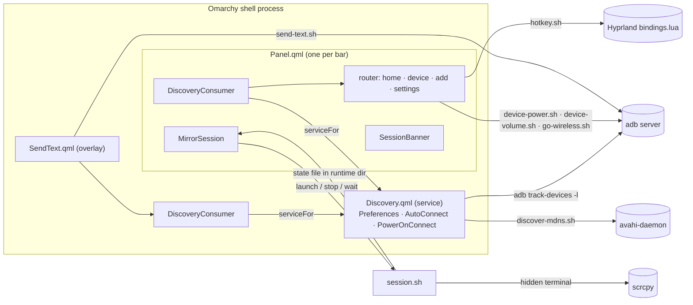

# OmaDroid architecture

OmaDroid is an Omarchy shell plugin (`pym.omadroid`): QML running inside the
Quickshell-based Omarchy shell, plus bash (and one Python) helpers that talk to
`adb`, `scrcpy`, `avahi-browse`, `hyprctl` and `secret-tool`. This page says
what runs where and how data flows between the parts. The reasons behind the
main choices are in the [Architecture Decision Records](adr/README.md); what
each release changed is in [CHANGELOG.md](../CHANGELOG.md).

## Entry points

`manifest.json` declares three kinds, each with its own entry point:

| Kind | Entry point | Lifetime |
| --- | --- | --- |
| `service` | `Discovery.qml` | One per shell process, created by the shell |
| `bar-widget` | `Panel.qml` | One per bar, so one per monitor |
| `overlay` | `SendText.qml` | The Send text prompt, toggled with `omarchy-shell shell toggle pym.omadroid` |

QML never builds shell strings: `Command.qml` runs one bounded command (argument
array, timeout, optional stdin, output kept as chunks) and `CommandStream.qml`
follows a long-running one (line or raw-chunk output, silent stop/restart,
`exited` only for exits nobody asked for). Pure logic lives in `.js` modules
that QML imports and Node tests load directly.

## Components and data flow

## Discovery service

`Discovery.qml` is the plugin's `service` entry point, so the shell creates it
once per process. Every widget reaches it through `DiscoveryConsumer.qml`, a
small adapter that calls `shell.serviceFor("pym.omadroid")` and forwards
`refresh()`, `holdMdns()`, `setPreference()` and `setAutoConnect()`. A consumer
owns no commands or timers; without a shell it exposes an empty stand-in so a
widget still loads.

- **ADB devices.** One `adb track-devices -l` stream (`CommandStream`, raw
  chunks) is decoded by `Model.takeTrackFrames` (4-hex length + payload). Nothing
  polls while it runs. If it stops, discovery polls `adb devices -l` every
  `refreshIntervalSec` (5–3600 s, default 15) and retries the tracker after
  1, 2, 4 … 60 s.
- **mDNS.** `discover-mdns.sh` keeps one `avahi-browse --resolve --parsable`
  per service type (`_adb._tcp`, `_adb-tls-connect._tcp`,
  `_adb-tls-pairing._tcp`), each under `setpriv --pdeathsig TERM`, and exits as
  soon as any browser stops. Lines are applied to a record map
  (`Model.applyMdnsLine`), sorted and parsed into `services`. The browsers run
  only while something wants them: a consumer that holds mDNS (an open popup),
  or Auto-connect being on. After a (re)start, old rows stay for a 1.5 s settle;
  a stopped browser is retried after 10 s.
- **Names and details.** `device-names.sh` reads `settings get global
  device_name` once per connection; `device-info.sh` reads battery, Android
  version, memory, screen and storage with one `adb shell` per device, only
  while a popup is open, refreshed after 60 s. Both are parsed in `Model.js` /
  `DeviceInfo.js`.
- **Rows.** `rows = Model.deviceRows(devices, services)` merges adb transports
  and mDNS services (one wireless endpoint per host; IPv4 preferred, every
  announced host kept in `hosts`). When adb holds several ready links to one
  device (a `host:port` link, one on the other address family — same port,
  model and product — or its own mDNS-named link), the row keeps a `host:port`
  link, IPv4 first, and lists the others in
  `aliases`; Disconnect drops them all. Auto-connect treats a link on any
  announced host as ready, so it never opens a second one.
  `Model.sameData` guards
  every published array, so an unchanged rescan rebuilds no view.
- **Owned children.** `Preferences.qml` (the `[preferences]` settings),
  `AutoConnect.qml` (connects remembered devices as they announce Wireless
  debugging; each endpoint tried once) and `PowerOnConnect.qml` (runs
  `device-power.sh connected` for newly ready devices: keepers back, optional
  wake/unlock) live in the service so two bars never act twice.

## Bar widget and popup router

`Panel.qml` draws the bar icon (ready count, a ▶/● session mark, urgent colour
when tools are missing) and its `KeyboardPanel` popup. It runs
`session.sh check` once at load, and again on open only while something is
missing. On open it holds mDNS and refreshes; on close it releases mDNS and
drops any QR code being shown.

The popup is a router over `view`:

| View | Component | Content |
| --- | --- | --- |
| `home` | `DeviceList.qml` / `DeviceRow.qml` | Rows grouped CONNECTED · NEEDS ATTENTION · NEARBY (`DeviceListModel.js`), one inline action per row |
| `device` | `DevicePage.qml` | Hero (`DevicePage.js`), session cards (`DeviceSessions.qml`), control row (`DeviceControls.qml`), Sound · Info sections |
| `add` | `AddDevicePage.qml` | QR code (`QrPairing.qml`, `qr-pair.sh`), pairing code, manual address (`Actions.qml`) |
| `settings` | `SettingsPane.qml` | Toggles, scan interval, Send text hotkey (`SendTextHotkey.qml`) |

`PanelHeader.qml` (back, title, ↻, ⚙) and `SessionBanner.qml` sit above every
view. Esc goes back, then closes; F5 refreshes. If the open device disappears,
the router returns home with a notice instead of showing another device.

`DeviceActions.js` holds two registries: session kinds (Mirror, Audio, Webcam
cards with summaries and switch hints) and device controls (Wake/Unlock, Lock,
Awake, Text, Wireless or Disconnect). A new feature is one registry entry plus
one handler (`startHandlers` in `DeviceSessions.qml`, `controlHandlers` in
`DevicePage.qml`).

## The scrcpy session

Only one scrcpy session (mirror, audio-only or webcam) runs per machine, and it
lives outside the shell process.

- **`session.sh`** owns it: `check`, `launch`, `run`, `status`, `path`, `wait`,
  `stop`, `rotate`. State lives in `$XDG_RUNTIME_DIR/omadroid-$UID` (from
  `proc-lib.sh`): `session` (pid, process start time, serial, type,
  recording path or webcam sink), plus `lock`, `launching`, `started`,
  `stopped`, `rotation` and `scrcpy.log`. A PID is trusted only if its
  `/proc` start time matches, so a reused PID is ignored.
- **Launch.** `launch` validates the request, refuses if a session is active or
  starting, writes the request to a NUL-separated file and starts a detached
  terminal (foot preferred, else the Omarchy default terminal; `terminal-lib.sh`)
  that runs `session.sh run`, which writes the state file and `exec`s scrcpy.
  `launch` waits for the `started` marker (3 s with foot, 8 s otherwise). A
  named Hyprland window rule (`hyprctl eval`) sends that terminal to the
  hidden `special:omadroid` workspace.
- **No polling.** Each `MirrorSession` watches the state file (`FileView` on
  `session.sh path`) and, while a session runs, keeps one `session.sh wait`
  that sleeps on the scrcpy PID (util-linux `waitpid`) and then ends the
  session, releasing a rotation lock OmaDroid set.
- **Stop.** `TERM`, up to 4 s for scrcpy to finalize recordings, then `KILL`.
- **`MirrorSession.qml`** is the non-visual QML side, one per panel, shared by
  the bar icon, the banner and every device page. It builds commands from
  `Model.js` / `Webcam.js`, runs optional wake/unlock first
  (`device-power.sh connected`, never blocking the launch), and implements
  switching: `launchMirror` / `launchWebcam` while a session runs become
  `switchTo`, which keeps a `pendingSwitch`, stops the session and launches
  once the status shows it ended. ■ cancels a pending switch. Webcam **Apply**
  is a switch to the same phone and output with `OMADROID_KEEP_READERS=1`.
- **Session UI.** `SessionCard.qml` shows the running session's controls (Log,
  Stop, recording, `ScreenPowerControls.qml`, `ScreenRotationControls.qml`,
  `WebcamPreview.qml`). The webcam preview runs `webcam-preview.sh`: ffmpeg
  reads the loopback output like any app and writes a small JPEG to the
  runtime dir. `webcam-devices.sh` lists and checks v4l2loopback outputs;
  `webcam-setup.sh` runs privileged setup in a visible terminal, only after a
  click.

## Device power and unlock

`device-power.sh` owns all power and lock I/O, serialized by
`power.lock` in the runtime dir. Devices are keyed by their live
`ro.serialno`, never their adb address.

- **Keep awake:** a window-less `scrcpy --no-video --no-audio --no-window
  --keep-active` keeper per device (`keepers/` in the runtime dir), remembered as
  a marker under `$XDG_STATE_HOME/omadroid/devices/<serial>/` and restarted on
  reconnect.
- **Wake / Lock:** `KEYCODE_WAKEUP`; `KEYCODE_SLEEP`, then the lock state is
  read back.
- **Unlock:** the PIN or password is in the desktop keyring (`secret-tool`,
  attributes `app omadroid`, `device`, `identity`). Unlock reads it inside the
  script, checks the device's `sha256(ro.serialno, android_id)` identity,
  confirms a PIN/password field via `uiautomator`, types once through
  `adb shell` stdin, and pauses unlocking (a `blocked` marker) if the lock
  screen stays. See [ADR 0004](adr/0004-unlock-pin-in-keyring-bound-to-device.md).

`DevicePowerState.qml` reads `device-power.sh status` for the device page;
`DeviceUnlockPin.qml` passes a newly typed secret to `secret-set` on stdin and
clears the field.

## Sound

`SoundPane.qml` (the Sound section) reads `device-volume.sh status` every 2 s,
only while it is shown and the popup is open, and drops a read that finished
for another device. `SoundVolume.js` parses the status and coalesces queued
changes (only a drag's last value is sent).

Streams and the ringer use `cmd audio`. Per-app volume (Samsung) and master
mute have no shell command, so they are `service call audio CODE` with
`IAudioService` transaction codes that change per firmware: on the first status
for a build fingerprint, `device-volume.sh` pulls
`/system/framework/framework.jar` and `audio-codes.py` parses the dex
(`IAudioService$Stub` `TRANSACTION_*` fields, strictly checked). Codes are
cached in `$XDG_CACHE_HOME/omadroid/audio-codes/` and verified on the device
(`getStreamVolume` vs `cmd audio get-stream-volume`) in the same `adb shell`
as every use. Unverified or missing codes fall back to app-op mute
(`PLAY_AUDIO`). See [ADR 0006](adr/0006-audio-codes-from-framework-jar.md).

App names: every status asks the device which package owns each playing uid
(`pm list packages --uid`), since uids are reassigned after a factory reset or
reinstall, and looks the name up by package in a per-device list built from
`pm list packages -U` and `scrcpy --list-apps`. scrcpy only names launchable
apps; for the rest `device-volume.sh` starts `app-labels.sh` in its own
session, which streams the app's `base.apk` over `adb shell -T` (script on
stdin, so no package name lands in a process's arguments) and reads the
label with `apk-label.py` (binary manifest + `resources.arsc`). Meanwhile
status prints `naming UID` and the row shows "reading name"; the label shows
on a later read, and a failure is retried after a day. One reader runs per
phone (a lock), so a slow pull isn't started again by every read.

## Send text

`SendText.qml` hosts a centered `PanelWindow`; `SendTextCard.qml` holds the
prompt state and keys, `SendTextSteps.qml` draws text and recorded key chips,
`SendTextDevices.qml` the device row. `SendText.js` maps Qt keys to step names
and picks the target (`lastTextTarget` preference, or the first ready device).
`send-text.sh SERIAL` reads one `text:` / `key:` step per line on stdin,
validates every step, then sends them in one `adb shell` chained with `&&`,
also on stdin, so typed text never appears in a process's arguments. The
hotkey is installed by
`hotkey.sh` into one marked block of Hyprland's `bindings.lua`, only from the
Settings page ([ADR 0005](adr/0005-external-config-only-via-install-button.md)).

## Storage

| What | Where |
| --- | --- |
| Preferences, Auto-connect list, mirror profiles, recording folder, webcam settings | `$XDG_CONFIG_HOME/omarchy/omadroid.ini` (Qt `Settings`; location from `SettingsFile.omadroidIniUrl`, computed at construction); mode 600, set by `settings-file.sh` at startup |
| Unlock PIN / password | Desktop keyring via `secret-tool` |
| Per-device markers (keep-awake, PIN identity hash, `blocked`) | `$XDG_STATE_HOME/omadroid/devices/` |
| Session state, keepers, locks, request files, preview JPEG, logs | `$XDG_RUNTIME_DIR/omadroid-$UID/` (mode 700) |
| Audio codes per firmware, app names and APK labels per device | `$XDG_CACHE_HOME/omadroid/` (folders 700, files 600) |
| Send text hotkey | One marked block in `~/.config/hypr/bindings.lua` (+ 2 newest backups) |

OmaDroid writes nothing in Omarchy's own configuration.

## Tests

`bash tests/run-all.sh` runs everything and prints `OMADROID_ALL_OK`; it fails
if a shell suite in `tests/` is missing from its list.

- **Node unit tests** (`node --test tests/*.test.cjs`): the `.js` modules,
  loaded by `tests/load-js.cjs` in a `vm` context that resolves `.import` lines
  the way QML does. No npm packages.
- **Shell suites with mocks:** the scripts with real side effects
  (`session.sh`, `device-power.sh`, `device-volume.sh`, `audio-codes.py`, `apk-label.py`,
  `go-wireless.sh`, `hotkey.sh`, `send-text.sh`, `settings-file.sh`,
  `webcam-setup.sh`) each have
  a suite in `tests/` that runs them against fake executables (`tests/mock-*.sh`: adb, scrcpy, avahi-browse,
  hyprctl, secret-tool, foot, qrencode, …) in a temporary directory, e.g. the
  PIN never appears in argv, one attempt then blocked, launch races, a binder
  table with a gap is refused (`tests/make-audio-dex.py` builds fixture dex
  files). `discover-mdns.sh` and `qr-pair.sh` are exercised from Node tests.
- **QML suites, offscreen:** `tests/shared-discovery.sh` (two consumers, one
  tracker; `no_track` variant falls back to polling) and `tests/smoke.sh`
  (`tests/Smoke.qml`, `tests/smoke/SmokeSessions.qml`) run `quickshell` with
  `QT_QPA_PLATFORM=offscreen`, isolated XDG dirs and the mocks first in `PATH`.
- **Preview harness:** `OMADROID_PREVIEW_DIR=… bash tests/smoke.sh` renders
  views to PNGs offscreen (`tests/Preview.qml`, or `HomePreview.qml` /
  `DevicePreview.qml` via `OMADROID_PREVIEW_QML`; views via
  `OMADROID_PREVIEW_PAGES`). A fake bar's shell serves a real `Discovery`
  against the mocks, and `tests/offscreen-ui/KeyboardPanel.qml` replaces the
  shell's `KeyboardPanel`, whose `PanelWindow` has no offscreen backend. See
  [ADR 0008](adr/0008-offscreen-preview-harness.md).

Hardware behaviour was checked by hand on a Samsung tablet running Android 16
over wireless ADB; fixture tests do not establish compatibility with other
devices.
